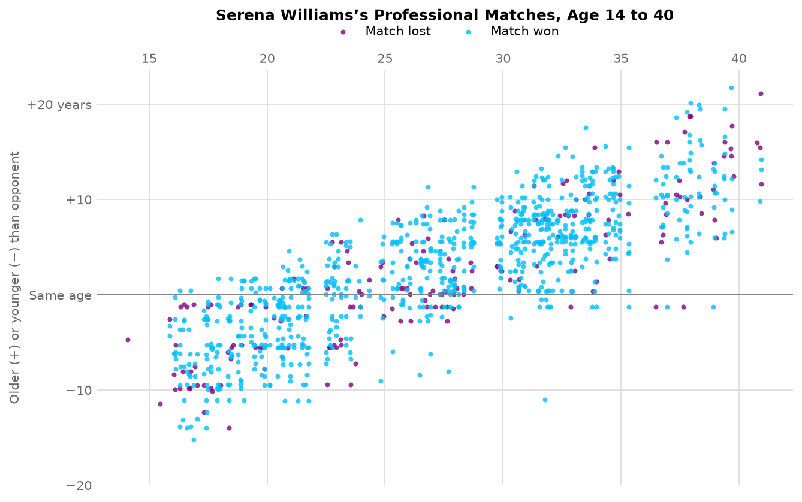

# tenniscareer

A Python package that downloads a tennis player's career matches from
[tennisabstract.com](https://www.tennisabstract.com) and plots them in the style of the
New York Times graphic of Serena Williams' career: the player's age on the x-axis, and how
much older or younger they were than each opponent on the y-axis.

## Installation

```bash
pip install git+https://github.com/UCB-stat159-f26/hw03-davdpanpan.git
```

Requires Python 3.9 or newer. `pandas`, `requests` and `matplotlib` are installed automatically.

## Usage

```python
from tenniscareer import get_career, plot_career

# Serena Williams data and plot
serena = get_career("serena williams")
plot_career(serena)

# Rafael Nadal data and plot
rafa = get_career("Rafael Nadal")
plot_career(rafa)

# Save a plot to a file
fig = plot_career(serena)
fig.savefig("serena.png")

# An unknown player raises a ValueError
get_career("GastonSanchez")
# ValueError: No player named 'GastonSanchez' found on tennisabstract.com. ...
```

## Example: Serena Williams

`get_career()` returns one row per match:

```python
from tenniscareer import get_career, plot_career

serena = get_career("serena williams")
serena.shape
# (1038, 13)

serena[["date", "tournament", "round", "result", "opponent",
        "player_age", "opponent_age", "age_diff"]].head()
```

```
        date       tournament round result                  opponent  player_age  opponent_age   age_diff
0 1995-10-30    Canadian Open    Q1      L               Anne Miller   14.101370     18.789041  -4.687671
1 1997-03-07     Indian Wells    Q1      L  Alexia Dechaume Balleret   15.454795     26.863014 -11.408219
2 1997-08-04  Manhattan Beach    Q3      L               Magui Serna   15.865753     18.441096  -2.575342
3 1997-08-04  Manhattan Beach    Q1      W             Amanda Basica   15.865753     19.136986  -3.271233
4 1997-08-04  Manhattan Beach    Q2      W       Tamarine Tanasugarn   15.865753     20.210959  -4.345205
```

```python
serena["result"].value_counts()
# W    862
# L    176
```

Plot her whole career:

```python
fig = plot_career(serena)
fig.savefig("serena-williams.png", dpi=150, bbox_inches="tight")
```



## Functions

### `get_career(player_name)`

Downloads a player's career matches and returns them as a pandas data frame, one row per match.

The name can be written as `"serena williams"`, `"Serena Williams"` or `"SerenaWilliams"`.
If tennisabstract.com has no player with that name, it raises a `ValueError`.

| Column | Description |
|---|---|
| `date` | Tournament start date |
| `tournament`, `surface`, `level`, `round` | Tournament name, court surface, tournament level and round |
| `result`, `won` | `"W"` or `"L"`, and the same result as `True`/`False` |
| `score` | Match score |
| `opponent` | Opponent's name |
| `opponent_age` | Opponent's age (years) at the match |
| `player_age` | Player's age (years) at the match |
| `age_diff` | `player_age - opponent_age`: positive when the player was older |
| `player` | Player's full name |

### `plot_career(career)`

Takes the data frame returned by `get_career()` and draws a scatter plot of `player_age`
vs. `age_diff`, with wins in blue and losses in purple. Returns the matplotlib figure.

## Running the tests

The tests use the mock career files in `tests/data/`.

```bash
git clone https://github.com/UCB-stat159-f26/hw03-davdpanpan.git
cd hw03-davdpanpan
pip install -e ".[test]"
pytest
```

## Project structure

```
src/tenniscareer/
    __init__.py      # exports get_career and plot_career
    data.py          # download and clean the career data
    plot.py          # draw the plot
tests/
    data/            # mock women's and men's career files
    test_data.py
    test_plot.py
images/              # example plots shown in this README
```

## Notes

- Women's career files give each opponent's date of birth, from which their age is
  calculated. Men's files give the opponent's age directly.
- The data is only as current as tennisabstract.com's career files.

## Reflections

Most of the work for this assignment was turning my HW2 scripts into functions that work for any player. The main change was removing anything specific to Serena Williams, such as her hard-coded date of birth, because the functions need to accept any player name. I chose to keep the cleaning step in its own function because it can be tested on the mock files without contacting tennisabstract.com. The biggest decision was how to tell the women's files apart from the men's files. I chose to use the number of fields per match because the women's mock file has 27 fields and the men's mock file has 47.